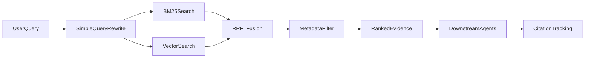

# Agentic Stock Intelligence Platform

Evidence-backed multi-agent stock intelligence system with **live market, news, and fundamentals data**. Produces explainable investment intelligence reports with citations. **Not** a price prediction system.

## Live data sources

| Source | Data |
|---|---|
| Yahoo Finance | Real-time news, price history, fundamentals |
| Google News RSS | Headline intelligence and sentiment |
| Seeded corpus | Fallback SEC/earnings excerpts for demo reliability |

When `ENABLE_LIVE_DATA=true` (default in Docker), each analysis run:

1. Fetches live news and classifies bullish/bearish signals
2. Pulls 1-month price trend and volatility from yfinance
3. Computes fundamentals score from live financial metrics
4. Ingests live headlines into the RAG index before retrieval

## Quick Start (Live)

```mermaid
flowchart TB
    subgraph frontend [NextJS_Web]
        AnalyzePage[AnalyzePage]
        LiveRunPage[LiveRunPage_SSE]
        ReportPage[ReportPage]
    end

    subgraph backend [FastAPI_API]
        AnalyzeAPI["POST /analyze"]
        StreamAPI["GET /runs/id/stream"]
        ReportAPI["GET /reports/id"]
        HITLAPI["POST /reports/id/decision"]
    end

    subgraph graph [LangGraph]
        Planner[PlannerAgent]
        Research[ResearchAgent]
        RAG[RAGEvidenceAgent]
        Risk[RiskSynthesisAgent]
        ReportAgent[ReportVerifyAgent]
        Planner --> Research --> RAG --> Risk --> ReportAgent
    end

    subgraph data [DataLayer]
        Ollama[Ollama_LLM]
        Qdrant[Qdrant]
        SQLite[SQLite]
        SampleData[SampleCorpus]
    end

    AnalyzePage --> AnalyzeAPI
    LiveRunPage --> StreamAPI
    ReportPage --> ReportAPI
    AnalyzeAPI --> graph
    graph --> Ollama
    RAG --> Qdrant
    graph --> SQLite
    SampleData --> Qdrant
```

## RAG Pipeline



### Run without Docker (recommended for company laptops)

No Docker, Qdrant, or Ollama required. Uses **BM25 RAG + live Yahoo/Google data**.

**Prerequisites:** Python 3.12, Node 20, network access for live data APIs.

```bash
git clone https://github.com/abi-raghavan/agentic-stock-intelligence.git
cd agentic-stock-intelligence
make local-setup
```

**Terminal 1 — API:**
```bash
make local-api
```

**Terminal 2 — Web UI:**
```bash
make local-web
```

Open **http://localhost:3000** and run the NVDA demo query.

| Component | Local mode |
|---|---|
| Live news/market | Yes (yfinance + Google RSS) |
| RAG retrieval | BM25 + seeded corpus + live headlines |
| LLM planner | Built-in fallback (no Ollama) |
| Vector search | Disabled (set `ENABLE_QDRANT=true` if you have Qdrant elsewhere) |

Copy `.env.local.example` → `.env` is done automatically by `make local-setup`.

---

### Run with Docker (optional)

```bash
cp .env.example .env
make deploy
```

Open:

- Web UI: http://localhost:3000
- API docs: http://localhost:8000/docs

Demo query:

```text
Ticker: NVDA
Question: Should I be worried about NVIDIA over the next 30 days?
```

## Architecture

See diagrams above for system, RAG, and agent workflow.

## Local Development

See **Run without Docker** above. Quick reference:

```bash
make local-setup   # once
make local-api     # terminal 1
make local-web     # terminal 2
```

## Evaluation

Offline retrieval evaluation:

```bash
python -m src.evaluation.run --data-dir sample_data
```

Methodology:

- Recall@5 on export-control topic for the NVIDIA demo query
- Citation correctness via verification agent checks
- Agent latency captured in `agent_runs.latency_ms`

## Project Structure

```text
agentic-stock-intelligence/
├── apps/web/              # Next.js frontend
├── apps/api/              # FastAPI entrypoint
├── src/agents/            # Agent implementations
├── src/graph/             # LangGraph workflow
├── src/rag/               # Hybrid retrieval + citations
├── src/tools/             # Market/news/LLM tools
├── src/scoring/           # Risk/opportunity scoring
├── sample_data/           # Seeded NVIDIA corpus
├── docker/                # Dockerfiles
└── tests/                 # Unit/integration tests
```

## Human-in-the-Loop

Reports are created in `draft` status. Users can:

- Approve
- Reject
- Re-run analysis

All actions are persisted in `audit_logs`.

## Disclaimer

This project provides research intelligence and risk analysis only. It does not provide financial advice or price predictions.

## Roadmap v2

- Cross-encoder reranking
- Parent-child chunking
- Evaluation dashboard UI
- GDELT / live RSS ingestion
- User auth and multi-tenant support
- Cross-encoder reranking and query rewriting with LLM
